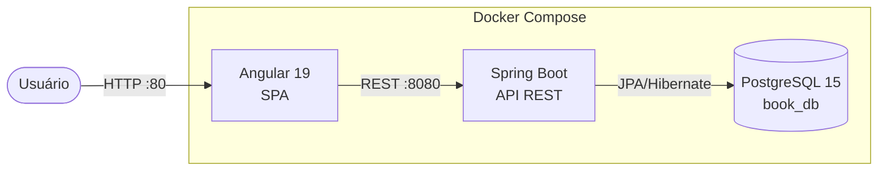

# Book Register

Aplicação full-stack para cadastro e gerenciamento de livros, com backend Spring Boot, frontend Angular e banco PostgreSQL — tudo containerizado com Docker e com pipeline CI/CD no GitHub Actions.

[](https://github.com/odavid062/book-register-/actions/workflows/ci.yml)
[](https://openjdk.org/projects/jdk/17/)
[](https://spring.io/projects/spring-boot)
[](https://angular.dev)
[](https://www.postgresql.org/)
[](https://docs.docker.com/compose/)
[](LICENSE)

---

## Arquitetura



---

## Funcionalidades

- Cadastrar livro com título, autor e ano de publicação
- Listar todos os livros cadastrados
- API documentada interativamente via Swagger UI
- Pipeline CI/CD com GitHub Actions (build + testes do backend a cada push)

---

## Stack Tecnológica

| Camada | Tecnologia | Versão |
|---|---|---|
| Frontend | Angular | 19.2 |
| Frontend | TypeScript | 5.7 |
| Backend | Java | 17 |
| Backend | Spring Boot | 3.4.4 |
| Backend | Spring Data JPA | — |
| Backend | Springdoc OpenAPI | 2.7.0 |
| Banco | PostgreSQL | 15 |
| Infra | Docker Compose | — |
| CI/CD | GitHub Actions | — |

---

## Como Executar

### Com Docker (recomendado)

```bash
git clone https://github.com/odavid062/book-register-.git
cd book-register-
docker compose up --build
```

| Serviço | URL |
|---|---|
| Frontend | http://localhost |
| Backend (API) | http://localhost:8080 |
| Swagger UI | http://localhost:8080/swagger-ui.html |
| PostgreSQL | localhost:5432 |

### Manualmente

**Backend:**
```bash
cd book-backend/backend
./mvnw spring-boot:run
```

**Frontend:**
```bash
cd book-frontend/spa-book-register
npm install
ng serve
```
Acesse em http://localhost:4200

---

## Endpoints da API

| Método | Rota | Descrição |
|---|---|---|
| `GET` | `/api/books` | Lista todos os livros |
| `POST` | `/api/books` | Cadastra novo livro |

### Exemplos

```bash
# Listar livros
curl http://localhost:8080/api/books

# Cadastrar livro
curl -X POST http://localhost:8080/api/books \
  -H "Content-Type: application/json" \
  -d '{"title": "Clean Code", "author": "Robert C. Martin", "publicationYear": 2008}'
```

---

## Estrutura do Projeto

```
book-register-/
├── .github/workflows/
│   └── ci.yml                          # Pipeline CI: build + testes Maven
├── book-backend/
│   ├── Dockerfile
│   └── backend/
│       └── src/main/java/book/backend/
│           ├── controller/
│           │   └── BookController.java  # GET e POST /api/books
│           ├── model/
│           │   └── BookModel.java       # Entidade JPA (id, title, author, publicationYear)
│           ├── repository/
│           │   └── BookRepository.java  # Spring Data JPA
│           └── CorsConfig.java
├── book-frontend/spa-book-register/
│   └── src/app/
│       ├── app.component.html           # Formulário + listagem
│       ├── book.service.ts              # HttpClient para /api/books
│       └── book.ts                      # Interface Book
├── docker-compose.yml
└── README.md
```

---

## CI/CD

O pipeline no GitHub Actions executa automaticamente a cada push ou pull request na branch `main`:

1. Checkout do código
2. Configura JDK 17 (Temurin)
3. Compila o backend e roda os testes com Maven (`./mvnw clean verify`)

---

## Autor

**David Rodrigues**
[](https://github.com/odavid062)

---

## Licença

[MIT](LICENSE)
